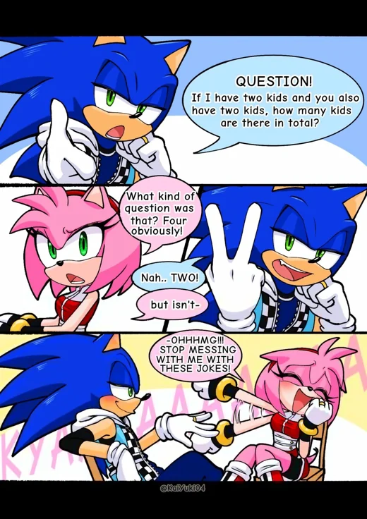
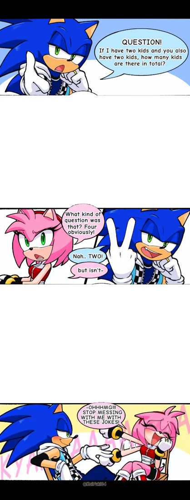
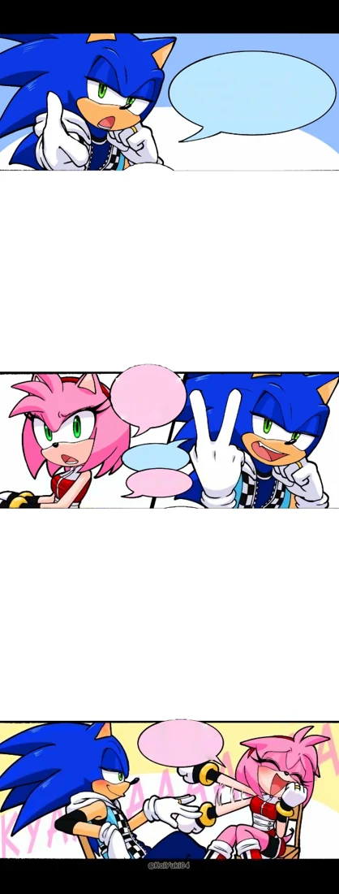
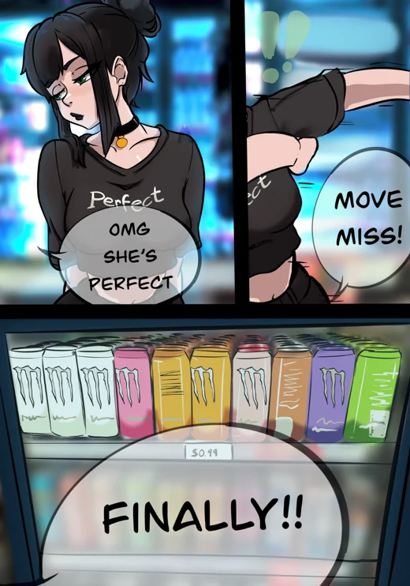
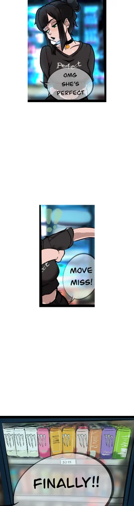
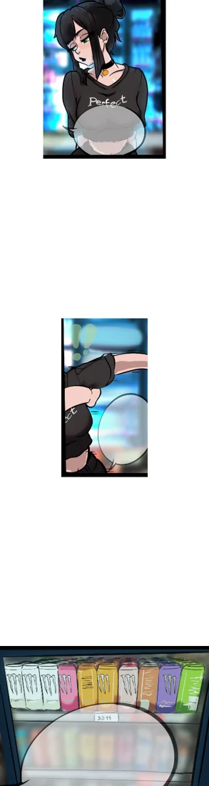
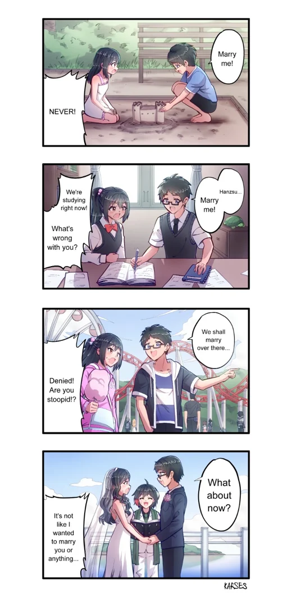
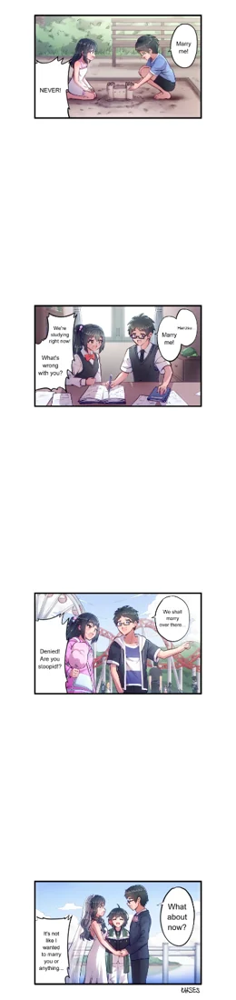
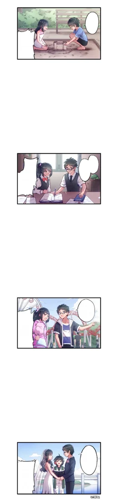

# FrameCut ✂️

**Cortador de quadros desgraçento — edição Kaline zé preguiça.**

Transforme páginas de quadrinhos em imagens verticais com espaço entre os quadros. Selecione uma imagem ou um lote inteiro: o FrameCut identifica os quadros, organiza a ordem de leitura e prepara os PNGs para baixar. Também permite esvaziar os balões.

**Gratuito, local e sem instalação.** Depois de baixar, funciona sem internet. As imagens são processadas no navegador e não são enviadas para um servidor.

## Baixar e começar

### 1. Baixe a versão pronta

**[⬇ Baixar FrameCut portátil em ZIP](https://github.com/NotOnepiecePlease/FrameCut/releases/latest/download/FrameCut-portatil.zip)**

O ZIP inclui o aplicativo e um tutorial que também funciona offline. Se preferir baixar somente o aplicativo, use **[FrameCut.html](https://github.com/NotOnepiecePlease/FrameCut/releases/latest/download/FrameCut.html)**.

Também é possível abrir a página de **[Releases](https://github.com/NotOnepiecePlease/FrameCut/releases/latest)**, procurar a seção **Assets** e clicar em `FrameCut-portatil.zip`. Os arquivos `Source code` são o código do projeto; para usar a ferramenta, escolha o ZIP portátil ou o HTML acima.

### 2. Extraia o ZIP

No Windows:

1. Abra a pasta **Downloads**.
2. Clique com o botão direito em `FrameCut-portatil.zip`.
3. Escolha **Extrair tudo…** e confirme **Extrair**.
4. Abra a pasta extraída.

### 3. Abra o aplicativo

Dê dois cliques em **`FrameCut.html`**. Se o Windows perguntar com qual programa abrir, escolha **Google Chrome** ou **Microsoft Edge**.

Se aparecer o código do arquivo em um editor, feche-o e use **botão direito → Abrir com → Chrome ou Edge**.

Pronto: não precisa instalar Python, Node.js, Photoshop ou iniciar localhost. O arquivo `COMO-USAR.html`, na mesma pasta, contém o guia de uso.

## Usar no dia a dia

### Preparar uma imagem ou várias de uma vez

1. Deixe **Quadros por imagem** em **Automático**.
2. Escolha a largura e a altura de saída. O padrão é **608 × 1600 pixels**.
3. Se quiser somente recortar e espaçar, **desmarque Esvaziar balões automaticamente**. Ela vem marcada por padrão.
4. Clique em **Escolher imagens**. Para selecionar várias no Windows, use **Ctrl + clique** ou **Ctrl + A** dentro da pasta.
5. Aguarde o processamento automático. Também pode arrastar os arquivos para a área de prévia.
6. Clique em cada imagem da fila para conferir o **Resultado automático**.
7. Baixe **este PNG** para uma imagem ou **o lote em ZIP** para todas as imagens prontas.

O navegador salva os arquivos na pasta de downloads configurada. Extraia o ZIP do resultado para acessar os PNGs.

**Confira os resultados antes de publicar.** A detecção é automática, mas algumas páginas podem precisar de correção.

### Tamanho e espaços

| Ajuste | O que faz |
| --- | --- |
| Quadros por imagem: Automático | Identifica a quantidade; um mesmo lote pode ter páginas com três, quatro ou mais quadros. |
| Quantidade específica | Permite informar de 2 a 12 quadros quando a detecção precisar de ajuda. |
| Largura de saída | Define a largura do PNG final. |
| Ajustar espaços para uma altura final | Calcula os intervalos brancos para chegar à altura escolhida. |
| Espaço fixo entre quadros | Fica disponível ao desmarcar o ajuste por altura; usa o intervalo informado em pixels. |

Se mudar as medidas depois de importar, clique em **Reprocessar lote**. Baixar o ZIP também aplica o padrão alterado.

Os quadros mantêm suas proporções em relação à página. Quadros estreitos ficam centralizados; eles não são esticados até a largura de um quadro maior. A leitura segue **de cima para baixo, da esquerda para a direita**.

Para reproduzir as dimensões dos exemplos desta documentação, use 608 × 1600 no Sonic, 426 × 1600 na página mista ou 378 × 1600 na página de quatro quadros. Os espaços são calculados; não são uma reprodução pixel por pixel dos intervalos escolhidos manualmente no Photoshop.

### Esvaziar os balões

Com **Esvaziar balões automaticamente** marcado, a limpeza é aplicada tanto à prévia quanto aos arquivos exportados.

- Em balões brancos ou coloridos opacos, procura a fala completa, incluindo pontuação e letras menores.
- Em balões transparentes, identifica os traços das letras e preenche essas áreas com cores próximas, evitando cobrir o fundo inteiro com um retângulo.
- O original continua disponível em **Conferir cortes**. Desmarque a opção para comparar com o resultado sem limpeza.

**O preenchimento é aproximado:** detalhes e texturas escondidos pelas letras podem ficar suavizados. Letras coloridas, textos muito curtos ou formatos diferentes podem não ser identificados. A contagem de balões limpos não garante que todo texto tenha sido encontrado.

### Corrigir um corte

1. Selecione a imagem na fila e clique em **Conferir cortes**.
2. Abra **Ajustes manuais e limpeza dos balões**.
3. Escolha **Ajustar divisões**.

Nos cortes com bolinhas verdes:

- **Arraste uma bolinha existente** para movê-la, sem criar outra. Os pontos internos podem se mover na horizontal e na vertical, respeitando os vizinhos.
- Use **Shift + clique** em um trecho livre da linha para acrescentar um ponto, ou escolha **Criar ou mover ponto**.
- Arraste um trecho sem bolinha para deslocar a linha.
- Clique com o botão direito perto da linha para removê-la.

Nos recortes retangulares:

- Arraste a borda do quadro para ajustar o recorte.
- Use **Selecionar quadro** para desenhar um novo retângulo.
- Clique com o botão direito dentro de um quadro para removê-lo.

Use **Desfazer** ou **Ctrl + Z** se precisar voltar. Confira o resultado e reprocese o lote antes de baixar.

### Corrigir a limpeza de um balão

Nos ajustes manuais, selecione **Limpar um balão com um clique** e clique no fundo claro, próximo das letras. Se não reconhecer a região, use **Retângulo**, **Elipse** ou **Pincel** para retoques. O **Conta-gotas** copia a cor de uma parte limpa do balão.

Essas ferramentas manuais aparecem sobre o original; o resultado final é exibido em **Resultado automático**. Os preenchimentos de seleção e pincel usam cor lisa.

## Exemplos

Imagens fornecidas para demonstração, com as assinaturas e créditos presentes nos originais preservados. As prévias abaixo foram reduzidas para a documentação; o aplicativo exporta nas medidas escolhidas.

### Quadros empilhados

| Original | Recortado e espaçado | Balões vazios |
| :---: | :---: | :---: |
|  |  |  |

### Dois quadros lado a lado e um abaixo

| Original | Ordem de leitura | Balões vazios |
| :---: | :---: | :---: |
|  |  |  |

### Quatro quadros com margens brancas

| Original | Recortado e espaçado | Balões vazios |
| :---: | :---: | :---: |
|  |  |  |

## Quando aparecer uma pendência

| Situação | Como resolver |
| --- | --- |
| **Revisar** na fila | Confira os cortes nos ajustes manuais ou informe a quantidade de quadros. Essa imagem não entra no ZIP até ser corrigida e reprocessada. |
| **Revisar texto** | Uma fala foi preservada porque a máscara não cobriu os traços identificados por inteiro. Confira e retoque a limpeza. |
| **0 balões** | Nenhum foi identificado; confira se ainda há texto. Não significa que a página já esteja limpa. |
| Altura final pequena | Aumente a altura ou diminua a largura de saída. |
| O navegador não baixou nada | Confira a pasta Downloads, o ícone de downloads e a mensagem na parte inferior do aplicativo. |
| Arquivo aparece como código | Abra `FrameCut.html` com Chrome ou Edge. |

O ZIP pode incluir **`REVISAR.txt`**, com imagens que ficaram de fora, e **`CONFERIR-LIMPEZA.txt`**, com avisos sobre falas preservadas.

## Limites e privacidade

- Entrada: PNG, JPG/JPEG ou WebP; até 24 megapixels e 16.000 pixels por lado.
- Saída: PNG; até 60 megapixels e 32.000 pixels de altura.
- Até 250 imagens por lote e 300 MB de PNGs gerados. Para trabalhos maiores, divida em lotes.
- A detecção automática reconhece até 12 quadros. Quadros sem bordas, diagonais ou sobrepostos podem precisar de recorte manual.
- O botão **Parar após esta imagem** interrompe o lote entre arquivos.
- **Baixe os resultados antes de fechar a aba ou substituir o lote.** Não há salvamento permanente de projeto.
- O desfazer usa até aproximadamente 100 MB e reinicia ao trocar de imagem. As edições são mantidas na fila durante a sessão.
- As imagens ficam no computador. O aplicativo não usa contas, serviços de tradução ou processamento remoto.

## Atualizar

Baixe a versão mais recente em [Releases](https://github.com/NotOnepiecePlease/FrameCut/releases/latest), extraia em uma nova pasta e abra o novo `FrameCut.html`. Salve o trabalho da versão anterior antes de fechá-la.

## Para desenvolver ou gerar uma release

O uso normal não exige ferramentas de desenvolvimento. Para alterar os fontes, use **Node.js 22 ou superior**; o empacotamento também usa **Python 3.10 ou superior**. Não há pacotes de terceiros para instalar.

```powershell
# Gerar o HTML independente
node build.cjs

# Verificar a versão independente em Chrome/Edge local
node verify.cjs --portable

# Preparar o HTML, tutorial, ZIP e checksums da release
python scripts/package_release.py
```

Os arquivos prontos ficam em `release/`. A versão vem do arquivo `VERSION`. Os fontes são `index.html`, `style.css`, `app.js`, `automation.js` e `balloon-cleaner.js`.

Para publicar depois de autenticar o GitHub CLI:

```powershell
git push origin main
git tag v1.0.0
git push origin v1.0.0
gh release create v1.0.0 release/FrameCut.html release/FrameCut-portatil.zip release/COMO-USAR.html release/SHA256SUMS.txt --repo NotOnepiecePlease/FrameCut --title "FrameCut v1.0.0" --notes-file RELEASE_NOTES.md --verify-tag
```

Na próxima versão, atualize `VERSION`, as notas e o nome da tag. Detalhes adicionais da implementação e dos testes estão em [LEIA-ME.md](LEIA-ME.md).
